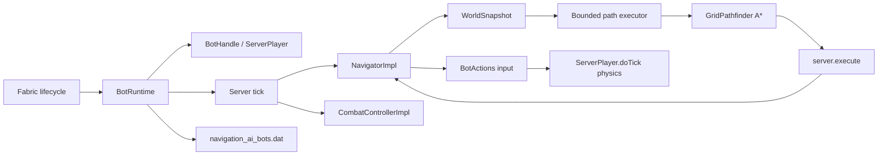

# Архитектура

Navigation AI разделён на публичный API, чистый модуль поиска и серверный runtime. Клиентская часть отсутствует.

## Пакеты

| Пакет | Ответственность |
| --- | --- |
| `dev.navigationai.api` | Стабильные интерфейсы и immutable records для модов-потребителей |
| `dev.navigationai.navigation` | `GridWorld`, `GridPath`, `GridPathfinder` и детерминированный A* без Minecraft-зависимостей |
| `dev.navigationai.runtime` | Жизненный цикл fake-player, снимки мира, тик, навигация и NBT |
| `dev.navigationai.mixin` | Accessor к внутренним коллекциям `PlayerList` для регистрации серверного игрока |

## Жизненный цикл fake-player

1. `BotRuntime.create` проверяет server thread и уникальность UUID.
2. Создаётся `ServerPlayer` с `GameProfile`, позицией, поворотом и стандартным `ClientInformation`.
3. К игроку прикрепляется отключённый `ServerGamePacketListenerImpl`; его `send` ничего не отправляет.
4. Игрок добавляется в `ServerLevel`, внутренние списки `PlayerList` и broadcast-ится как новый игрок.
5. На каждом серверном тике сначала обновляется навигатор, затем вызывается `ServerPlayer.doTick()`.
6. `remove` отменяет участие в `PlayerList`, отправляет пакет удаления другим игрокам и удаляет сущность из уровня.

У fake-player нет сетевого соединения в `ServerConnectionListener`. Поэтому серверная физика запускается явно из runtime, а код, который ожидает реальный входящий packet stream, к боту неприменим.

## Боевой цикл

`CombatControllerImpl` работает в server thread перед `ServerPlayer.doTick()`. При
активном бою он временно получает приоритет над навигатором и каждый тик:

1. проверяет, что цель жива, разрешена политикой, находится в том же измерении и
   не ушла за `maxFollowDistance`;
2. выбирает меч, топор или лук из инвентаря;
3. вычисляет точку на хитбоксе, плавно ограничивает изменение yaw/pitch и подаёт
   движение относительно текущего взгляда;
4. проверяет блокирующий луч и ошибку прицеливания;
5. выполняет `ServerPlayer.attack` или реальный цикл `BowItem` только после
   задержки реакции и восстановления cooldown.

Контроллер не вызывает `hurtServer` напрямую и не корректирует траекторию после
выпуска стрелы. Это сохраняет урон, броню, зачарования, расход стрел и физику
ванильных предметов.

## Потоки и границы данных

| Операция | Поток |
| --- | --- |
| Создание/удаление игрока, NBT, чтение мира | server thread |
| `WorldSnapshot.capture` | server thread |
| A* и восстановление пути | worker-поток bounded executor |
| Применение результата и управление игроком | server thread через `server.execute` |

`WorldSnapshot` содержит только immutable-набор доступных `GridPos` и границы снимка. Worker-поток не читает `ServerLevel`, блоки, чанки или сущности напрямую.

## Навигационный цикл

1. `NavigatorImpl.goTo` отменяет предыдущую задачу и фиксирует новую цель/политику.
2. Runtime снимает локальную область вокруг старта, ограниченную `snapshotRadius`. Если цель дальше этой области, она превращается в ближайший локальный waypoint, после достижения которого запускается следующий сегмент.
3. `GridPathfinder` ищет путь детерминированным A* с четырьмя горизонтальными, двумя вертикальными и восемью вертикально-диагональными переходами, проверкой диагональных углов, опасных клеток и `maxPathLength`. Поиск ограничен `maxSearchNodes`.
4. Результат с номером поколения возвращается в server thread. Старый результат отбрасывается, если за это время была отмена или новое перепланирование.
5. Навигатор превращает следующий узел в yaw и стандартный ввод движения. Прыжок включается, когда следующий узел выше текущего; на лестнице используется вертикальный ввод. После последнего узла финального сегмента для `PositionGoal` и `BlockGoal` может выполняться короткий прямой подход к точке/центру блока.
6. При отсутствии прогресса более 40 тиков или после обнаружения новой опасности/препятствия запускается ограниченное перепланирование. После трёх безуспешных попыток задача получает `STUCK` и останавливает ввод.

Перед переходом навигатор открывает закрытую деревянную дверь или люк только после проверки `mayInteract`, проверяет динамическую занятость клетки и замечает новые блоки/опасности. При изменении мира он ограниченно перепланирует маршрут. Если следующий узел содержит разрешённое препятствие, навигатор временно передаёт управление общему исполнителю `Miner`. Для перехода без опоры при `allowPlacing=true` он выбирает простой полный блок из инвентаря, проверяет разрешения и устанавливает его под переходом. После изменения мира маршрут снимается заново.

Снимок рассматривает проходными в основном воздушные двухблочные объёмы с опорой под ногами; исходящая и текущая вода допускаются при `allowWater=true`, а лава — нет. Низкие частичные поверхности и `CLIMBABLE`-блоки имеют отдельные правила. Огонь, магма, кактус, порошковый снег, лава в клетке или под опорой и соседние живые сущности попадают в immutable-набор опасностей. Это сознательно небольшой базовый слой, а не полная модель всех блоков Minecraft.

## Планирование ресурсов

Для runtime создаётся общий fixed thread pool размером от 1 до 4 (`availableProcessors() - 1`, ограничение сверху 4) с bounded очередью из 64 запросов. Бот не получает отдельный поток. Серверный тик не ждёт завершения A*: он продолжает симуляцию, пока задача находится в `COMPUTING`.

Параметры, которые ограничивают работу одного поиска:

- `snapshotRadius` ограничивает объём чтения мира;
- `maxSearchNodes` ограничивает число раскрытых узлов;
- bounded executor ограничивает параллелизм поиска.

Эти ограничения делают десятки ботов предсказуемее, но не являются гарантией конкретного TPS: стоимость `ServerPlayer.doTick`, сущностей и чанков остаётся на сервере.

## Сохранение

На `SERVER_STOPPING` runtime записывает список ботов в сжатый NBT-файл `<world>/navigation_ai_bots.dat`. Для каждого бота сохраняются имя, измерение и данные `ServerPlayer` через `saveWithoutId`. Если навигатор выполняет задачу, рядом сохраняются тип цели, её координаты или UUID цели `FollowGoal`, а также все поля `NavigationPolicy`.

При загрузке сначала восстанавливаются fake-player и их предметы/позиции, затем активные цели перечитываются из NBT и запускаются заново по свежему снимку мира. Это намеренно не продолжение старого пути: маршрут строится заново, поэтому изменения чанков между остановкой и запуском учитываются. Цель `FollowGoal` разрешается по UUID после создания всех сохранённых ботов; недоступная или повреждённая цель пропускается с предупреждением. Если измерение недоступно, конкретный бот пропускается, а файл сохраняется для ручного восстановления.
