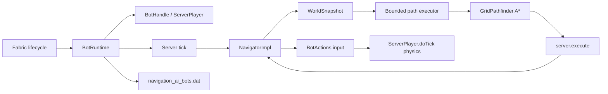

# Архитектура

Navigation AI разделён на публичный API, чистый модуль поиска и серверный runtime. Клиентская часть отсутствует.

## Пакеты

| Пакет | Ответственность |
| --- | --- |
| `dev.navigationai.api` | Стабильные интерфейсы и immutable records для модов-потребителей |
| `dev.navigationai.navigation` | `GridWorld`, `GridPath`, `GridPathfinder` и детерминированный A* без Minecraft-зависимостей |
| `dev.navigationai.runtime` | Жизненный цикл fake-player, снимки мира, тик, навигация и NBT |
| `dev.navigationai.mixin` | Accessor к внутренним коллекциям `PlayerList` для регистрации серверного игрока |

## Жизненный цикл fake-player

1. `BotRuntime.create` проверяет server thread и уникальность UUID.
2. Создаётся `ServerPlayer` с `GameProfile`, позицией, поворотом и стандартным `ClientInformation`.
3. К игроку прикрепляется отключённый `ServerGamePacketListenerImpl`; его `send` ничего не отправляет.
4. Игрок добавляется в `ServerLevel`, внутренние списки `PlayerList` и broadcast-ится как новый игрок.
5. На каждом серверном тике сначала обновляется навигатор, затем вызывается `ServerPlayer.doTick()`.
6. `remove` отменяет участие в `PlayerList`, отправляет пакет удаления другим игрокам и удаляет сущность из уровня.

У fake-player нет сетевого соединения в `ServerConnectionListener`. Поэтому серверная физика запускается явно из runtime, а код, который ожидает реальный входящий packet stream, к боту неприменим.

## Потоки и границы данных

| Операция | Поток |
| --- | --- |
| Создание/удаление игрока, NBT, чтение мира | server thread |
| `WorldSnapshot.capture` | server thread |
| A* и восстановление пути | worker-поток bounded executor |
| Применение результата и управление игроком | server thread через `server.execute` |

`WorldSnapshot` содержит только immutable-набор доступных `GridPos` и границы снимка. Worker-поток не читает `ServerLevel`, блоки, чанки или сущности напрямую.

## Навигационный цикл

1. `NavigatorImpl.goTo` отменяет предыдущую задачу и фиксирует новую цель/политику.
2. Runtime снимает локальную область вокруг старта, ограниченную `snapshotRadius`; цель за пределами снимка быстро считается недостижимой, чтобы далёкая цель не заставляла сервер обходить весь прямоугольник между точками.
3. `GridPathfinder` ищет путь A* с четырьмя горизонтальными и восемью вертикально-диагональными переходами. Поиск ограничен `maxSearchNodes`.
4. Результат с номером поколения возвращается в server thread. Старый результат отбрасывается, если за это время была отмена или новое перепланирование.
5. Навигатор превращает следующий узел в yaw и стандартный ввод движения. Прыжок включается, когда следующий узел выше текущего.
6. При отсутствии прогресса более 40 тиков запускается перепланирование.

Снимок рассматривает проходными в основном воздушные двухблочные объёмы с опорой под ногами; вода допускается при `allowWater=true`. Это сознательно небольшой базовый слой, а не полная модель всех блоков Minecraft.

## Планирование ресурсов

Для runtime создаётся общий fixed thread pool размером от 1 до 4 (`availableProcessors() - 1`, ограничение сверху 4). Бот не получает отдельный поток. Серверный тик не ждёт завершения A*: он продолжает симуляцию, пока задача находится в `COMPUTING`.

Параметры, которые ограничивают работу одного поиска:

- `snapshotRadius` ограничивает объём чтения мира;
- `maxSearchNodes` ограничивает число раскрытых узлов;
- bounded executor ограничивает параллелизм поиска.

Эти ограничения делают десятки ботов предсказуемее, но не являются гарантией конкретного TPS: стоимость `ServerPlayer.doTick`, сущностей и чанков остаётся на сервере.

## Сохранение

На `SERVER_STOPPING` runtime записывает список ботов в сжатый NBT-файл `<world>/navigation_ai_bots.dat`. Для каждого бота сохраняются имя, измерение и данные `ServerPlayer` через `saveWithoutId`. При загрузке измерение разрешается через registry access, после чего игрок создаётся и загружается через `player.load`.

Если измерение недоступно, конкретный бот пропускается, а файл сохраняется для ручного восстановления. Задачи навигации не сериализуются.
