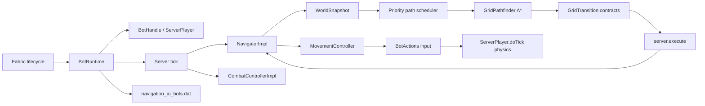

# Архитектура

Navigation AI разделён на публичный API, чистый модуль поиска и серверный runtime. Клиентская часть отсутствует.

## Пакеты

| Пакет | Ответственность |
| --- | --- |
| `dev.navigationai.api` | Стабильные интерфейсы и immutable records для модов-потребителей |
| `dev.navigationai.navigation` | `GridWorld`, `GridPath`, `GridPathfinder` и детерминированный A* без Minecraft-зависимостей |
| `dev.navigationai.runtime` | Жизненный цикл fake-player, снимки мира, тик, навигация и NBT |

## Жизненный цикл fake-player

1. `BotRuntime.create` проверяет server thread и уникальность UUID.
2. Создаётся `ServerPlayer` с `GameProfile`, позицией, поворотом и стандартным `ClientInformation`.
3. К игроку прикрепляется отключённый `ServerGamePacketListenerImpl`; его `send` ничего не отправляет.
4. Игрок регистрируется через vanilla `PlayerList.placeNewPlayer`, поэтому используются обычные списки, broadcast и tracking-путь сервера.
5. На каждом серверном тике сначала обновляется навигатор, затем вызывается `ServerPlayer.doTick()`.
6. `remove` использует vanilla `PlayerList.remove`, который синхронно выполняет сохранение/очистку игрока, broadcast удаления и удаление сущности из уровня.

У fake-player нет сетевого соединения в `ServerConnectionListener`. Поэтому серверная физика запускается явно из runtime, а код, который ожидает реальный входящий packet stream, к боту неприменим.

## Боевой цикл

`CombatControllerImpl` работает в server thread перед `ServerPlayer.doTick()`. При
активном бою он временно получает приоритет над навигатором и каждый тик:

1. проверяет, что цель жива, разрешена политикой, находится в том же измерении и
   не ушла за `maxFollowDistance`;
2. выбирает меч, топор или лук из инвентаря;
3. вычисляет точку на хитбоксе, плавно ограничивает изменение yaw/pitch и подаёт
   движение относительно текущего взгляда;
4. проверяет блокирующий луч и ошибку прицеливания;
5. выполняет `ServerPlayer.attack` или реальный цикл `BowItem` только после
   задержки реакции и восстановления cooldown.

Контроллер не вызывает `hurtServer` напрямую и не корректирует траекторию после
выпуска стрелы. Это сохраняет урон, броню, зачарования, расход стрел и физику
ванильных предметов.

## Потоки и границы данных

| Операция | Поток |
| --- | --- |
| Создание/удаление игрока, NBT, чтение мира | server thread |
| `WorldSnapshot.capture`, все мутации и `Task.cancel()` | server thread |
| A* и восстановление пути | worker-поток priority scheduler |
| Применение результата и управление игроком | server thread через `server.execute` |

`WorldSnapshot` содержит набор доступных `GridPos` и границы снимка; после публикации наборы больше не изменяются. Worker-поток не читает `ServerLevel`, блоки, чанки или сущности напрямую. `snapshotRadius` ограничен диапазоном 4..64 как верхний предел политики; первичный горизонтальный радиус не превышает 16 блоков и для близкой цели уменьшается до расстояния до неё с запасом в четыре блока, но не ниже восьми блоков, если политика это допускает. Если близкая цель недоступна в этом снимке, радиус расширяется до предела политики. По высоте снимок охватывает 16 блоков вверх и вниз от бота, а в сторону цели может расшириться до 32 блоков; дальняя цель достигается frontier-сегментами. Серверный поток снимает не более 4096 блоковых позиций за тик для всех ботов вместе и не более 2048 за один вызов бота. После завершения снимка поиск передаётся в worker-поток.

## Навигационный цикл

1. `NavigatorImpl.goTo` отменяет предыдущую задачу и фиксирует новую цель/политику.
2. Runtime ставит tickets на локальную область при разрешённой генерации, снимает область вокруг старта, ограниченную `snapshotRadius` по горизонтали и 16–32 блоками в направлении по высоте, и передаёт A* настоящую дальнюю цель. Неизвестная часть мира остаётся за границами снимка и не считается проходимой; генерация разрешается отдельным тик-бюджетом. Тип билета `navigation_ai:navigation` регистрируется при инициализации мода и не сохраняется в мире. Minecraft объединяет билеты одного типа и уровня без учёта владельца, поэтому использование `PLAYER_LOADING` для маршрутов недопустимо: очистка маршрута удаляла бы билеты игроков. Пересекающиеся маршруты одного runtime удерживают собственные билеты до освобождения последней ссылки.
3. `GridPathfinder` ищет путь детерминированным A* с обычными шагами, спринтерскими прыжками на 2–4 блока в любом горизонтальном направлении, контролируемыми спусками до `maxFallDistance`, вертикальными и диагональными переходами, проверкой диагональных углов, опасных клеток и `maxPathLength`. При `allowWater=true` вода допустима без отдельного лимита длины, но имеет повышенную стоимость. Прыжок проверяет движущийся объём тела по общей для снимка и исполнителя приближённой дуге: вход, потолок, опору и обе крайние клетки. Crouch-only клетки не служат концами прыжка. Поиск ограничен `maxSearchNodes`; при границе снимка или исчерпании бюджета он возвращает лучший frontier-маршрут вместо пустого результата.
4. Runtime начинает снимать следующий участок от конца frontier-маршрута до завершения движения по текущему участку. Неизменившиеся снимки или классификации клеток переиспользуются; изменения блоков отслеживаются ревизиями чанков и их соседей. Результат с номером поколения возвращается в server thread. Старый результат отбрасывается, если за это время была отмена или новое перепланирование.
5. A* сохраняет GridTransition с типом, позой, высотами опоры, условиями отрыва/посадки и действиями с блоками. Исполнитель проверяет этот контракт через общие TransitionRules и небольшой живой WorldSnapshot. MovementController управляет разгоном, боковой коррекцией и торможением по положению и скорости; фазы прыжка не позволяют повторно запускать переход после посадки. После последнего узла финального сегмента для `PositionGoal` и `BlockGoal` может выполняться короткий подход к точке/блоку с повторной проверкой коллизий, опасностей, опоры и позы. Составные цели переходят к следующему waypoint, `LookAtGoal` сразу применяет поворот, а `DimensionGoal` выполняет серверный переход измерения.
6. При отсутствии прогресса более 40 тиков или после обнаружения новой опасности/препятствия запускается ограниченное перепланирование. После трёх безуспешных попыток задача получает `STUCK` и останавливает ввод.

Если поиск не находит путь на границе ещё не загруженных чанков, навигатор делает до 20 отложенных повторов без принудительной генерации. После исчерпания попыток задача завершается как недостижимая.

Перед переходом навигатор открывает закрытую вручную открываемую дверь или люк только после проверки `mayInteract`, проверяет динамическую занятость клетки и замечает новые блоки/опасности. При изменении мира он ограниченно перепланирует маршрут. Если следующий узел содержит разрешённое препятствие, навигатор временно передаёт управление общему исполнителю `Miner`. Для перехода без опоры при `allowPlacing=true` он выбирает простой полный блок из инвентаря, проверяет разрешения и устанавливает его под переходом. После изменения мира маршрут снимается заново.

Снимок добавляет к базовой стоимости перехода оценку действий: ожидаемое время разрушения с лучшим доступным инструментом (включая Efficiency и состояние прочности) или штраф за установку опоры. Поэтому разрушение и строительство остаются допустимыми fallback-действиями, но плоский обход обычно выбирается раньше тоннеля или моста. Каждое успешное размещение попадает в журнал навигационной транзакции; при обычной отмене, ошибке или `STUCK` журнал восстанавливает исходные блоки и предметы. Пока `Miner` разрушает препятствие, счётчик пространственного застревания приостановлен; ошибка или `STUCK` навигации отменяет активную добычу. При штатной остановке runtime сохраняет состояние игрока, активную цель и журнал размещений в NBT до удаления fake-player. После перезапуска он восстанавливает журнал перед новым поиском пути, чтобы более поздняя отмена могла откатить прежние опоры.

Снимок рассматривает проходными в основном воздушные двухблочные объёмы с опорой под ногами; исходящая и текущая вода допускаются при `allowWater=true` и получают повышенную стоимость, а лава — нет. Для дальнего прыжка снимок проверяет всю траекторию: пустота, опасные клетки, диагональные углы и высота препятствия. Разрешены только стены не выше одного блока; закрытые двери, заборы и двухблочные стены не считаются прыжковыми переходами. Низкие частичные поверхности, короткие прыжки и клетки, где требуется sneak, имеют отдельные правила; закрытые низкие люки в таком туннеле не открываются автоматически. Огонь, магма, кактус, порошковый снег и лава в клетке или под опорой попадают в immutable-набор опасностей; занятые живыми существами клетки исключаются из маршрута, а соседние получают повышенную стоимость. Это сознательно небольшой базовый слой, а не полная модель всех блоков Minecraft.

## Планирование ресурсов

Для ограниченного `maxPathLength` A* сохраняет альтернативы одной позиции по двум признакам: стоимости и числу шагов. Более дорогой короткий подход не отбрасывается в пользу дешёвого длинного, который уже не укладывается в лимит. Путь содержит неизменяемую цепочку родителей. `maxFallDistance=0` запрещает и одноблочные спуски; движение по лестнице или вниз в воде не считается падением. Входная клетка колонки спуска проверяется вместе со всеми промежуточными клетками.

`BlockGoal` с занятым целевым блоком ищет все доступные соседние подходы одним поиском. PositionGoal ищет допустимую область прибытия, а не только клетку занятой цели. При фоновом поиске сохраняется безопасный текущий путь; новый результат стыкуется в общей будущей точке, сохраняя активный переход, в том числе прыжок в полёте. Метрики задачи суммируют раскрытые узлы её поисков и учитывают время от вызова API до завершения всей задачи.

Снимок учитывает количество доступных безопасных полных блоков для опор; A* считает их расход на локальном маршруте. Исполнитель повторно проверяет материал перед размещением. Падающие блоки, опасные поверхности и block entity не используются. Сканирование ресурсов инкрементальное, кандидаты помещаются в очередь по расстоянию во время скана; выбранный ресурс резервируется задачей до завершения попытки. Отмена, ошибка и успех освобождают резервирование.

Запуск контроллеров защищён поколением запроса: новая задача, созданная из callback отмены, остаётся владельцем управления, а прерванный внешний вызов возвращает завершённую отменённую задачу. После удаления или смерти бота новые задачи запускать нельзя.

Для runtime создаётся общий priority thread pool размером от 1 до 4 (`availableProcessors() - 1`, ограничение сверху 4) с bounded очередью из 64 запросов. Приоритет позволяет обгонять ограниченное число более старых запросов; возраст отложенного запроса повышает его приоритет. Одинаковые приоритеты выполняются FIFO. При отмене старый `Future` прерывается, а A* периодически проверяет interrupt-флаг. Бот не получает отдельный поток. Серверный тик не ждёт завершения A*: он продолжает симуляцию, пока задача находится в `COMPUTING`.

Параметры, которые ограничивают работу одного поиска:

- `snapshotRadius` ограничивает объём чтения мира и валидируется в диапазоне 4..64;
- `maxSearchNodes` ограничивает число раскрытых узлов и валидируется в диапазоне 128..200000;
- `maxPathLength` валидируется в диапазоне 1..16384;
- priority scheduler ограничивает параллелизм и размер очереди поиска;
- бюджет снимков ограничивает синхронное чтение мира на одном серверном тике.

При росте числа ботов runtime автоматически снижает лимиты снимков, A* и генерации чанков; при медленном полном серверном тике лимиты дополнительно уменьшаются. Захват снимков и скан ресурсов делят бюджет 2–5 мс на тик; порядок ботов циклически меняется для равного доступа к работе. Один вызов чтения мира или генерации чанка нельзя прервать посередине, поэтому этот бюджет ограничивает начало следующей операции и не гарантирует абсолютный верхний предел. Это делает десятки ботов предсказуемее, но не является гарантией конкретного TPS: стоимость `ServerPlayer.doTick`, сущностей и чанков остаётся на сервере.

## Сохранение

На `SERVER_STOPPING` runtime сначала останавливает контроллеры, отменяет только поисковые worker-задачи и сохраняет список ботов в сжатый NBT-файл `<world>/navigation_ai_bots.dat`. Запись строится во временный файл и заменяет основной через atomic move с безопасным fallback, поэтому ошибка записи не обнуляет последнюю рабочую копию. Для каждого бота сохраняются имя, измерение и данные `ServerPlayer` через `saveWithoutId`. Если навигатор выполняет задачу, рядом сохраняются тип цели (включая составные цели и измерение), её координаты или UUID цели игрока, а также все поля `NavigationPolicy`.

При загрузке сначала восстанавливаются fake-player и их предметы/позиции, затем активные цели перечитываются из NBT и запускаются заново по свежему снимку мира. Это намеренно не продолжение старого пути: маршрут строится заново, поэтому изменения чанков между остановкой и запуском учитываются. Цель `FollowGoal` разрешается по UUID после создания всех сохранённых ботов; недоступная или повреждённая цель пропускается с предупреждением. Если измерение недоступно, конкретный бот пропускается, а файл сохраняется для ручного восстановления.

Подробности контрактов, кеширования и измерений отдельной задачи описаны в [этапе развития навигации](NAVIGATION_TRANSITIONS_2026-09-26.md).
