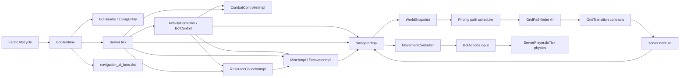

# Архитектура

Navigation AI разделён на публичный API, чистый модуль поиска и серверный runtime. Клиентская часть отсутствует.

Общие контроллеры читают положение и геометрию через `LivingEntity`.
`BotHandleImpl` связывает их с `ServerPlayer` либо `VillagerController`.
Для жителя ванильный тик выполняется миром ровно один раз, а временное владение
движением подавляет конкурирующие vanilla AI-контроллеры. `ActorSupport` и
незарегистрированный `VillagerActionPlayer` изолируют операции, требующие Player;
контекст не регистрируется в мире/PlayerList и не получает собственную физику.
Сохранение жителей, загрузка чанков и перенос между измерениями описаны в
[VILLAGERS.md](VILLAGERS.md).

## Пакеты

| Пакет | Ответственность |
| --- | --- |
| `dev.navigationai.api` | Стабильные интерфейсы и immutable records для модов-потребителей |
| `dev.navigationai.navigation` | `GridWorld`, `GridPath`, `GridPathfinder` и детерминированный A* без Minecraft-зависимостей |
| `dev.navigationai.runtime` | Жизненный цикл fake-player, снимки мира, тик, навигация и NBT |

## Жизненный цикл fake-player

1. Инициализация `BotRuntime` и `create` выполняются в server thread; `create` проверяет открытое состояние runtime и уникальность UUID.
2. Создаётся `ServerPlayer` с `GameProfile`, позицией, поворотом и стандартным `ClientInformation`.
3. К игроку прикрепляется отключённый `ServerGamePacketListenerImpl`; его `send` ничего не отправляет.
4. Игрок регистрируется через vanilla `PlayerList.placeNewPlayer`, поэтому используются обычные списки, broadcast и tracking-путь сервера.
5. На каждом серверном тике применяется полученный через исходящий packet knockback, обновляются последовательность действий, сборщик, добыча и бой. Если бой не активен, затем обновляется навигатор; после контроллеров вызывается `ServerPlayer.doTick()`.
6. `remove` сначала помечает бота удалённым и отменяет его задания, затем освобождает резервирование, navigation tickets и ожидающее восстановление. Vanilla `PlayerList.remove` синхронно выполняет сохранение/очистку игрока, broadcast удаления и удаление сущности из уровня.

У fake-player нет сетевого соединения в `ServerConnectionListener`. Поэтому серверная физика запускается явно из runtime, а код, который ожидает реальный входящий packet stream, к боту неприменим.

## Боевой цикл

`CombatControllerImpl` работает в server thread перед `ServerPlayer.doTick()`. При
активном бою он временно получает приоритет над навигатором и каждый тик:

1. проверяет цель, измерение и `maxFollowDistance`, а также лимиты длительности,
   отсутствия видимости и здоровья из `CombatTactics`;
2. выбирает меч, топор или лук по дистанции, доступности стрел и поднятому щиту;
   пороги входа/выхода из стрельбы и задержка смены ограничивают частые замены;
3. вычисляет точку на хитбоксе, плавно ограничивает изменение yaw/pitch и подаёт
   движение относительно текущего взгляда;
4. проверяет ошибку прицеливания и первую сущность или блок на луче реального
   взгляда; ближний удар также ограничен ванильной дальностью взаимодействия;
5. выполняет `ServerPlayer.attack` или реальный цикл `BowItem` только после
   задержки реакции и восстановления cooldown.

Контроллер не вызывает `hurtServer` напрямую и не корректирует траекторию после
выпуска стрелы. Это сохраняет урон, броню, зачарования, расход стрел и физику
ванильных предметов.

Движение при `safeMovement` проверяет опору, коллизии, опасности, жидкости и
загруженность чанков перед подачей ввода. Щит из offhand используется через
обычный `startUsingItem` между ударами и снимается перед атакой. Каждый
`CombatTask` хранит собственный `CombatDiagnostics`: контроллер очищает состояние
до завершения future, поэтому callback может начать новый бой, сохраняя финальное
наблюдение прежнего задания.

## Добыча и шахты

`MinerImpl` разрушает блок через ванильный прогресс и `ServerPlayerGameMode`,
проверяя права, загруженность, видимость, дальность и инструмент. Отмена снимает
визуальный прогресс разрушения и восстанавливает выбранный слот. У навигатора,
сборщика и шахты есть дочерние вызовы добычи, которые сохраняют владельца корня.

`ExcavatorImpl` управляет циклом «подход — проверка участка — добыча сверху вниз —
проход вперёд». Тоннель имеет два блока высоты, лестница вниз — три блока
просвета на участке. Перед первым разрушением проверяется весь очередной
участок: безопасный пол, права, жидкости и их соседство, падающие блоки и
block entity. Движение и возврат выполняются дочерним `NavigatorImpl`.

Число завершённых участков и фактических разрушений учитывает дочернюю операцию,
завершившуюся в текущем тике. Это позволяет сохранить точный остаток бюджета
между завершением `MiningTask` и следующим обновлением шахты. Нулевой бюджет
допускает движение по уже свободному проходу. Отмена сохраняет добытые блоки
и предметы; журнал компенсации размещений относится к навигационным опорам.

## Потоки и границы данных

| Операция | Поток |
| --- | --- |
| Создание/удаление игрока, NBT, чтение мира | server thread |
| `WorldSnapshot.capture`, все мутации и `Task.cancel()` | server thread |
| A* и восстановление пути | worker-поток priority scheduler |
| Применение результата и управление игроком | server thread через `server.execute` |
| Вызов `BotService.submit` | любой поток после получения сервиса |
| Исполнение переданной в `submit` операции | server thread через очередь `TickTask` |
| Создание `BotSnapshot` и `InventorySnapshot` | server thread |
| Чтение готового снимка | любой поток |

`submit` всегда ставит операцию в очередь, в том числе при вызове из server thread.
Отмена future до исполнения пропускает операцию; начатая операция не прерывается.
Операции интегратора выполняются на серверном потоке и должны быть короткими.
Инициализация runtime разрешена только на серверном потоке; ссылка на активный
runtime публикуется через `volatile`.

`BotInventoryImpl` проверяет слоты и тип экипировки, отменяет прежнее корневое
задание и меняет стеки местами. После callback отмены содержимое проверяется
повторно. `InventorySnapshot` копирует стеки при создании и при каждом обращении
к `slots()`, поэтому наблюдение не даёт доступа к изменяемому инвентарю игрока.

`WorldSnapshot` содержит набор доступных `GridPos` и границы снимка; после публикации наборы больше не изменяются. Worker-поток не читает `ServerLevel`, блоки, чанки или сущности напрямую. `snapshotRadius` ограничен диапазоном 4..64 как верхний предел политики; первичный горизонтальный радиус не превышает 16 блоков и для близкой цели уменьшается до расстояния до неё с запасом в четыре блока, но не ниже восьми блоков, если политика это допускает. Если близкая цель недоступна в этом снимке, радиус расширяется до предела политики. По высоте снимок охватывает 16 блоков вверх и вниз от бота, а в сторону цели может расшириться до 32 блоков; дальняя цель достигается frontier-сегментами. Серверный поток снимает не более 4096 блоковых позиций за тик для всех ботов вместе и не более 2048 за один вызов бота. После завершения снимка поиск передаётся в worker-поток.

## Навигационный цикл

1. `NavigatorImpl.goTo` отменяет предыдущую задачу и фиксирует новую цель/политику.
2. Runtime постепенно ставит tickets на локальную область при разрешённой генерации, снимает область вокруг старта, ограниченную `snapshotRadius` по горизонтали и 16–32 блоками в направлении по высоте, и передаёт A* настоящую дальнюю цель. Неизвестная часть мира остаётся за границами снимка и не считается проходимой. Захват снимка не запускает синхронную генерацию чанка: tickets запрашивают её отдельно, с ограничением числа новых tickets за тик. Тип билета `navigation_ai:navigation` регистрируется при инициализации мода и не сохраняется в мире. Minecraft объединяет билеты одного типа и уровня без учёта владельца, поэтому использование `PLAYER_LOADING` для маршрутов недопустимо: очистка маршрута удаляла бы билеты игроков. Пересекающиеся маршруты одного runtime удерживают собственные билеты до освобождения последней ссылки.
3. `GridPathfinder` ищет путь детерминированным A* с обычными шагами, спринтерскими прыжками на 2–4 блока в любом горизонтальном направлении, контролируемыми спусками до `maxFallDistance`, вертикальными и диагональными переходами, проверкой диагональных углов, опасных клеток и `maxPathLength`. При `allowWater=true` вода допустима без отдельного лимита длины, но имеет повышенную стоимость. Прыжок проверяет движущийся объём тела по общей для снимка и исполнителя приближённой дуге: вход, потолок, опору и обе крайние клетки. Crouch-only клетки не служат концами прыжка. Поиск ограничен `maxSearchNodes`; при границе снимка или исчерпании бюджета он возвращает лучший frontier-маршрут вместо пустого результата.
4. Runtime начинает снимать следующий участок от конца frontier-маршрута до завершения движения по текущему участку. Неизменившиеся снимки или классификации клеток переиспользуются; изменения блоков отслеживаются ревизиями чанков и их соседей. Результат с номером поколения возвращается в server thread. Старый результат отбрасывается, если за это время была отмена или новое перепланирование.
5. A* сохраняет GridTransition с типом, позой, высотами опоры, условиями отрыва/посадки и действиями с блоками. Исполнитель проверяет этот контракт через общие TransitionRules; неизменённая геометрия использует готовый снимок, изменённая снимается небольшими порциями в общем тик-бюджете. Пока перепроверка не закончилась, бот тормозит на устойчивой опоре. MovementController управляет разгоном, боковой коррекцией и торможением по положению и скорости; фазы прыжка не позволяют повторно запускать переход после посадки. После последнего узла финального сегмента для `PositionGoal` и `BlockGoal` может выполняться короткий подход к точке/блоку с повторной проверкой коллизий, опасностей, опоры и позы. Составные цели переходят к следующему waypoint, `LookAtGoal` сразу применяет поворот, а `DimensionGoal` выполняет серверный переход измерения.
6. При отсутствии прогресса более 40 тиков или после обнаружения новой опасности/препятствия запускается ограниченное перепланирование. После трёх безуспешных попыток задача получает `STUCK` и останавливает ввод.

Если поиск не находит путь на границе ещё не загруженных чанков, навигатор делает до 20 отложенных повторов без принудительной генерации. После исчерпания попыток задача завершается как недостижимая.

Для дальней цели frontier выбирается среди граничных клеток снимка, в том числе когда выход требует временно удалиться от цели. Задача хранит до 8192 клеток уже принятых промежуточных маршрутов, чтобы повторно не выбирать тот же выход; при смене waypoint история очищается. Дополнительно A* сохраняет до 64 выходов из восьмиблочных областей, а задача удерживает граф максимум из 256 направленных рёбер. Обратный переход добавляется только после проверки обратимости локального пути. Пересечения маршрутов стыкуют фоновые участки. Если обычный frontier исчерпан и цель остаётся за пределами известной области, граф выбирает возврат к известной развилке; допускается не более 64 таких запросов. Изменение/выгрузка чанка снимает геометрическую проверенность ребра и повышает его стоимость. Топология остаётся ограниченной подсказкой: каждый участок к выбранной точке снова ищется по свежему снимку; старый путь из графа не исполняется. Недоступная точка исключается.

Опоры, установленные незавершённым маршрутом, переносятся в журнал безопасного отката. Каждый тик проверяется до 16 записей с циклическим выбором, поэтому занятая опора не задерживает остальные записи. Под ботом и другими сущностями опора сохраняется; возврат предмета выполняется только после успешного удаления и проверки состояния блока. Журнал сохраняется даже без активной цели. При явном удалении бота необходимые другим сущностям опоры остаются в мире.

Перед переходом навигатор открывает закрытую вручную открываемую дверь или люк только после проверки `mayInteract`, проверяет динамическую занятость клетки и замечает новые блоки/опасности. При изменении мира он ограниченно перепланирует маршрут. Если следующий узел содержит разрешённое препятствие, навигатор временно передаёт управление общему исполнителю `Miner`. Для перехода без опоры при `allowPlacing=true` он выбирает простой полный блок из инвентаря, проверяет разрешения и устанавливает его под переходом. После изменения мира маршрут снимается заново.

Снимок добавляет к базовой стоимости перехода оценку действий: ожидаемое время разрушения с лучшим доступным инструментом (включая Efficiency и состояние прочности) или штраф за установку опоры. Поэтому разрушение и строительство остаются допустимыми fallback-действиями, но плоский обход обычно выбирается раньше тоннеля или моста. Каждое успешное размещение попадает в журнал навигационной транзакции; при обычной отмене, ошибке или `STUCK` журнал восстанавливает исходные блоки и предметы. Пока `Miner` разрушает препятствие, счётчик пространственного застревания приостановлен; ошибка или `STUCK` навигации отменяет активную добычу. При штатной остановке runtime сохраняет состояние игрока, активную цель и журнал размещений в NBT до удаления fake-player. После перезапуска он восстанавливает журнал перед новым поиском пути, чтобы более поздняя отмена могла откатить прежние опоры.

Снимок рассматривает проходными в основном воздушные двухблочные объёмы с опорой под ногами; исходящая и текущая вода допускаются при `allowWater=true` и получают повышенную стоимость, а лава — нет. Для дальнего прыжка снимок проверяет всю траекторию: пустота, опасные клетки, диагональные углы и высота препятствия. Разрешены только стены не выше одного блока; закрытые двери, заборы и двухблочные стены не считаются прыжковыми переходами. Низкие частичные поверхности, короткие прыжки и клетки, где требуется sneak, имеют отдельные правила; закрытые низкие люки в таком туннеле не открываются автоматически. Огонь, магма, кактус, порошковый снег и лава в клетке или под опорой попадают в immutable-набор опасностей; занятые живыми существами клетки исключаются из маршрута, а соседние получают повышенную стоимость. Это сознательно небольшой базовый слой, а не полная модель всех блоков Minecraft.

## Планирование ресурсов

Для ограниченного `maxPathLength` A* сохраняет альтернативы одной позиции по двум признакам: стоимости и числу шагов. Более дорогой короткий подход не отбрасывается в пользу дешёвого длинного, который уже не укладывается в лимит. Путь содержит неизменяемую цепочку родителей. `maxFallDistance=0` запрещает и одноблочные спуски; движение по лестнице или вниз в воде не считается падением. Входная клетка колонки спуска проверяется вместе со всеми промежуточными клетками.

`BlockGoal` с занятым целевым блоком ищет все доступные соседние подходы одним поиском. PositionGoal ищет допустимую область прибытия, а не только клетку занятой цели. При фоновом поиске сохраняется безопасный текущий путь; новый результат стыкуется в общей будущей точке, сохраняя активный переход, в том числе прыжок в полёте. Метрики задачи суммируют раскрытые узлы её поисков и учитывают время от вызова API до завершения всей задачи.

Снимок учитывает количество доступных безопасных полных блоков для опор; A* считает их расход на локальном маршруте. Исполнитель повторно проверяет материал перед размещением. Падающие блоки, опасные поверхности и block entity не используются. Сканирование ресурсов инкрементальное и идёт концентрическими оболочками: ближайшие кандидаты выбираются до окончания полного скана; выбранный ресурс резервируется задачей до завершения попытки. Отмена, ошибка и успех освобождают резервирование.

После разрушения сборщик ставит шесть соседей жилы в приоритетную очередь
кандидатов в пределах исходной области поиска. Ранее недоступный ресурс может
получить новый подход после открытия соседнего блока. Скан остаётся ограничен
общим бюджетом runtime; область поиска не перемещается вслед за ботом.

Все публичные высокоуровневые контроллеры делят `BotControl`: новый корневой запрос отменяет предыдущий, дочерние вызовы не захватывают корень. `ActivityController` хранит намерение отдельно от пути и количества оставшихся предметов; [контракт прерывания и сохранения](ACTIVITIES.md). Запуск контроллеров защищён поколением запроса: новая задача, созданная из callback отмены, остаётся владельцем управления, а прерванный внешний вызов возвращает завершённую отменённую задачу. После удаления или смерти бота новые задачи запускать нельзя.

`BotHandle.stopAll()` получает ручной корень, отменяет контроллеры, останавливает
ввод и использование предмета. Если callback назначил новый корень, метод
возвращает `false` и сохраняет его управление. `BotActions.stop()` меняет только
ввод и не отменяет активное намерение. Изменения через `BotInventory` следуют
тому же правилу приоритета callback.

Для runtime создаётся общий priority thread pool размером от 1 до 4 (`availableProcessors() - 1`, ограничение сверху 4) с bounded очередью из 64 запросов. Приоритет позволяет обгонять ограниченное число более старых запросов; возраст отложенного запроса повышает его приоритет. Одинаковые приоритеты выполняются FIFO. При отмене старый `Future` прерывается, а A* периодически проверяет interrupt-флаг. Бот не получает отдельный поток. Серверный тик не ждёт завершения A*: он продолжает симуляцию, пока задача находится в `COMPUTING`.

Параметры, которые ограничивают работу одного поиска:

- `snapshotRadius` ограничивает объём чтения мира и валидируется в диапазоне 4..64;
- `maxSearchNodes` ограничивает число раскрытых узлов и валидируется в диапазоне 128..200000;
- `maxPathLength` валидируется в диапазоне 1..16384;
- priority scheduler ограничивает параллелизм и размер очереди поиска;
- бюджет снимков ограничивает синхронное чтение мира на одном серверном тике.

Готовность чанков проверяется через неблокирующий `getChunkNow`, включая соседние
чанки для collision shapes на границе. `hasChunk` показывает также запрошенные,
ещё не готовые чанки и для этой проверки не подходит. Незагруженные клетки
пропускаются; navigation tickets продолжают асинхронную загрузку. Лимит
одновременно ожидающих чанков снимается после фактической готовности FULL-чанка.

При росте числа ботов runtime автоматически снижает лимиты снимков, A* и запросов загрузки чанков; при медленном полном серверном тике лимиты дополнительно уменьшаются. Захват снимков, перепроверка переходов и скан ресурсов делят бюджет 2–5 мс на тик; порядок ботов циклически меняется для равного доступа к работе. Один вызов чтения мира нельзя прервать посередине, поэтому этот бюджет ограничивает начало следующей операции и не гарантирует абсолютный верхний предел. Синхронная генерация из захвата снимка исключена, но стоимость работы ванильного планировщика чанков остаётся на сервере. Это делает десятки ботов предсказуемее, но не является гарантией конкретного TPS: стоимость `ServerPlayer.doTick`, сущностей и чанков также зависит от мира.

## Сохранение

NBT runtime версии 3 также хранит активную последовательность действий: шаги,
индекс, счётчик исходных предметов, время сбора и ожидания, завершённые участки
шахты, число разрушений и ограниченное боевое прерывание с `CombatTactics`.
Она восстанавливается после создания всех fake-player и обычных навигационных
целей, затем захватывает управление и создаёт свежую дочернюю задачу. Подробные
правила и ошибки восстановления — в [описании последовательностей](ACTIVITIES.md).

Ожидающее восстановление хранит поколение управления. Новая публичная команда
в первые тики после загрузки отменяет возобновление старого намерения;
сохранённые размещения остаются доступными для безопасного отката. Дочерняя
шахта после продолжения получает оставшиеся время и бюджет разрушений, а
ожидание — уже прошедшие тики. Отдельные задачи добычи, шахты, сбора и боя
вне последовательности не восстанавливаются.

При закрытии runtime запрещает создание ботов и новые задания до остановки
контроллеров. Ожидающие `submit` завершаются исключением; callback отмены не
может запустить новую работу в закрывающемся runtime. Повторный `close` не
выполняет очистку заново.

На `SERVER_STOPPING` runtime сначала останавливает контроллеры, отменяет только поисковые worker-задачи и сохраняет список ботов в сжатый NBT-файл `<world>/navigation_ai_bots.dat`. Запись строится во временный файл и заменяет основной через atomic move с безопасным fallback, поэтому ошибка записи не обнуляет последнюю рабочую копию. Для каждого бота сохраняются имя, измерение и данные `ServerPlayer` через `saveWithoutId`. Если навигатор выполняет задачу, рядом сохраняются тип цели (включая составные цели и измерение), её координаты или UUID цели игрока, а также все поля `NavigationPolicy`.

При загрузке сначала восстанавливаются fake-player и их предметы/позиции, затем активные цели перечитываются из NBT и запускаются заново по свежему снимку мира. Это намеренно не продолжение старого пути: маршрут строится заново, поэтому изменения чанков между остановкой и запуском учитываются. Цель `FollowGoal` разрешается по UUID после создания всех сохранённых ботов; недоступная или повреждённая цель пропускается с предупреждением. Если измерение недоступно, конкретный бот пропускается, а файл сохраняется для ручного восстановления.

Подробности контрактов, кеширования и измерений отдельной задачи описаны в [этапе развития навигации](NAVIGATION_TRANSITIONS_2026-09-26.md).
