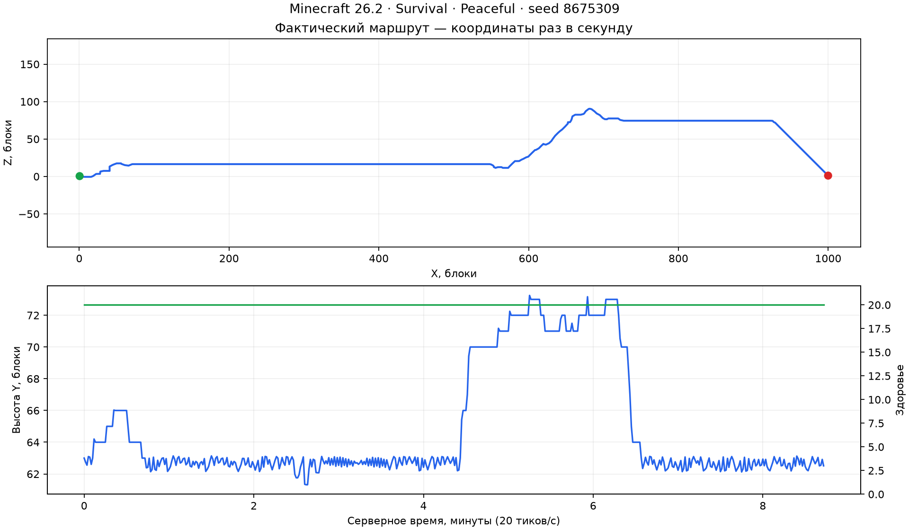

# Реализация и проверка 27.09.2026

Полный прогон итоговой сборки завершился успешно: 72 модульных теста,
108 игровых сценариев и длительные задания на настоящем сервере Minecraft 26.2.
Исходники и оба JAR после прогона сверены с SHA-256 в
[машинном отчёте](../tools/regression/results/2026-09-27/report.json).

## Что изменено

- Единое владение управлением: новый публичный запуск навигации, сбора, добычи,
  боя или последовательности отменяет прежнее корневое задание. Дочерние
  контроллеры продолжают совместную работу. Повторные вызовы из callback отмены
  сохраняют управление за более новым запросом.
- `ActivityController` выполняет навигацию, сбор и добычу по очереди. Ограниченный
  бой приостанавливает шаг; после успеха маршрут пересчитывается, а сбор получает
  оставшееся количество. План, текущий шаг, прогресс и лимит сохраняются в NBT.
  Контракты и пример интеграции описаны в [ACTIVITIES](ACTIVITIES.md).
- Скан ресурсов идёт от ближайших клеток и выбирает кандидата до окончания
  большого куба. Исправлены подход к ресурсу в полу, защита опоры под ботом,
  принадлежность выпавшей добычи и подход к отлетевшему предмету.
- Ограниченный граф связности хранит развилки и проверенные обратные переходы.
  Бот может отступить из дальнего тупика. Каждый следующий участок строится по
  свежему снимку; сохранённые пути не исполняются напрямую.
- Полная ширина тела учитывает других игроков, Follow выбирает доступную позицию
  возле цели, а короткий спуск проверяет высоту тела до падения под навес.
- Снимок и выбор места добычи проверяют готовые чанки через `getChunkNow`,
  включая соседей для collision shapes. Запрошенный, но ещё не готовый чанк
  пропускается. Счётчик ожидающей загрузки снимается только после готовности.
- Loom закреплён на `1.17.21` в библиотеке и потребителе. Исходная стабильная
  версия сохранена тегом `stable-2026-09-26` на commit
  `3e642e2438bd647e339e7d15b77bf446650d10cd`.

## Итоговые проверки

| Проверка | Результат |
| --- | --- |
| JUnit | 72/72 |
| Публичный API, selftest | 22 проверки |
| Lifecycle navigation tickets | PASS; билеты игроков сохранены |
| Основная регрессия | 51/51 |
| Регрессии ревью | 15/15 |
| Сочетания переходов | 10/10, зависших задач нет |
| Регрессии исправлений | 15/15, включая незавершённую загрузку чанка |
| Последовательности и безопасный сбор | 17/17 |
| Реальная остановка и запуск сервера | После одного предмета восстановлены сбор ровно пяти и возврат |
| Дальний тупик | SUCCESS, вход в тупик подтверждён, 5 возвратов через граф |
| Природный маршрут к цели в 1000 блоках | SUCCESS |
| 12 ботов, пять раундов смешанных заданий | 60/60 задач, установлено 405 опор |
| Одновременная навигация 50 ботов | 50/50, 357 тиков |

Проверки длительных заданий также подтверждают освобождение navigation tickets,
резервов ресурсов и предметов после удаления ботов. Реальный перезапуск проводится
отдельным процессом Java; это не только сериализация NBT в памяти.

## Природный маршрут

Новый обычный мир: seed `8675309`, survival, peaceful, обычные 20 тиков/с.
Бот получил алмазные инструменты и булыжник для опор. Подготовлены только чанки
двух конечных точек; промежуточные чанки загрузила навигация. После старта
телепортации, полёта и бессмертия нет.

- Старт: `(0.5, 63, 0.5)`; цель: `(1000.5, 63, 0.5)`, допуск 1.5 блока.
- Финиш: `(999.847, 62.514, 1.153)`.
- Время: **522.02 с**, то есть **8 минут 42 секунды**, 10459 тиков.
- Фактическая длина по горизонтали: **1098.57 блока** с обходами.
- Длина с вертикальными перемещениями: 1420.11 блока; сюда входит качание на воде.
- Здоровье во всех 524 записанных точках: **20/20**.

[Координаты и здоровье](../tools/regression/results/2026-09-27/journey.csv)
сохранены раз в секунду, включая старт и финиш.



## Нагрузка и оставшиеся пределы

Ниже указаны миллисекунды **полного завершённого серверного тика** за конкретное
задание. Подготовка искусственных арен исключена. Накопительные поля LOAD и
`NavigationMetrics` охватывают всю жизнь runtime и не заменяют эти измерения.

| Задание | Среднее | p95 | p99 | Максимум |
| --- | ---: | ---: | ---: | ---: |
| Природный маршрут | 1.47 | 5.19 | 7.36 | 566.89 |
| Смешанные 12 ботов | 4.59 | 5.89 | 16.98 | 139.21 |
| Короткие маршруты 50 ботов | 5.48 | 8.21 | Не измерялся этим набором | 101.21 |

Смешанная сцена длится 181.81 с: шесть встречных пешеходов, три сборщика с
возвратом и три строителя мостов под низким потолком. Все 12 ботов завершили
её с 20/20 здоровья. Разрывы ограждены так, чтобы их нельзя было обойти по арене;
в каждом раунде проверены все 27 опор каждого моста.

JFR предварительного запуска показал синхронное ожидание чанка в
`WorldSnapshot.Capture.step`. После исправления в JFR итогового перезапущенного
сервера таких `ThreadPark` нет. Ожидания загрузки остаются в ванильном
`ServerPlayer.doTick` при старте и входе на местность. Поэтому бюджет планирования
2–5 мс не является жёстким пределом всей симуляции. Редкие пики и GC сохранены
в профиле; гарантии постоянных 20 TPS для любого мира нет.

Это испытание одного seed и данной машины. Граф ограничен 256 рёбрами и 64
возвратами на цель; успешный проход не доказывает достижимость любой точки.
Следующее расширение испытаний — несколько seed и наборы эффектов/поверхностей
с изменённой физикой. Автоматический выбор боя остаётся задачей интегратора.

## Повторение и артефакты

Из корня библиотеки, Python 3 и JDK 25:

```text
python tools/regression/run-validation.py --server-template ../navigation-fixes-validation/server --suite core,activities,persistence,regions,journey,mixed,load --port 25586 --profile
```

Точные SHA-256 проверенных JAR:

```text
navigation-ai-0.1.0.jar
601b257e240722e62800fae285925c8560fb6dfa06f62e1ffe67a51320d2f14e
navigation-ai-practice-test-0.1.0.jar
32c9038b658ce8eb6a72d3a2cd84795b2d58eb6e430c997d93c162b08f8e9c19
```

Сборки находятся в `build/libs` библиотеки и потребителя. Новые изменения пока
находятся в рабочей копии; Git tag выше относится к исходной стабильной версии.

Полные логи, сборки, два JFR, GC и мир оставлены в
`build/validation/20260927-134631`. Мир расположен в
`server/validation-world`; сервер штатно остановлен. Основной мир и настройки
существующего сервера не менялись. Результаты JSON/CSV/PNG также скопированы в
`tools/regression/results/2026-09-27`, чтобы пережить `gradlew clean`.
